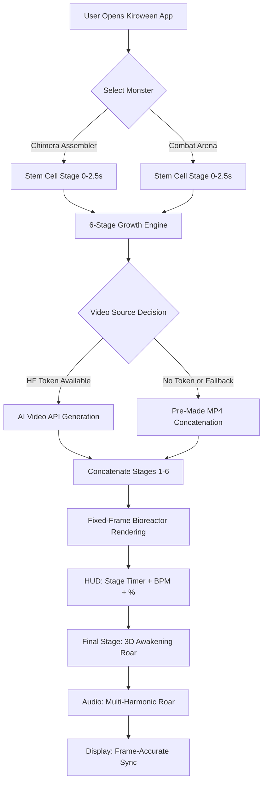

# Design Document: Kiroween Rearchitecture - 15-Second 6-Stage Bio-Growth Timelapse

## Overview

This rearchitecture introduces a **15-second documentary-style timelapse** showing continuous biological growth across 6 distinct stages (Stem Cell → Cell Division → Embryo → Growth & Morphogenesis → Juvenile → Adult), replacing static monster videos with a scientifically accurate growth sequence. The system implements a **hybrid video pipeline** that prioritizes AI video generation but falls back to pre-made MP4 concatenation when API keys are unavailable, ensuring NO CSS jitter, NO fake shaking effects, and 100% frame-accurate synchronization.

**Key Innovation**: Each monster video must show the full 6-stage biological growth sequence (0-15s) rather than only the final adult form, creating an immersive "laboratory documentary" experience where users watch the monster develop from a single stem cell to a roaring adult filling the bioreactor chamber.

## Architecture



### Architecture Components

```
┌─────────────────────────────────────────────────────────────────────┐
│                     Kiroween Rearchitecture                         │
├─────────────────────────────────────────────────────────────────────┤
│  ┌──────────────────────────────────────────────────────────────┐  │
│  │                    High-Level Layers                         │  │
│  ├──────────────────────────────────────────────────────────────┤  │
│  │ • User Interface Layer (React Components)                    │  │
│  │ • Video Pipeline Layer (Hybrid: API + Fallback)             │  │
│  │ • Growth Engine Layer (15s 6-Stage Sequencer)               │  │
│  │ • Rendering Layer (Fixed-Frame Bioreactor)                   │  │
│  └──────────────────────────────────────────────────────────────┘  │
│  ┌──────────────────────────────────────────────────────────────┐  │
│  │                    Component Hierarchy                       │  │
│  ├──────────────────────────────────────────────────────────────┤  │
│  │ • BioStitchLabView (Main Container)                          │  │
│  │   ├─ BioreactorContainer (Fixed-Frame Glass Chamber)        │  │
│  │   │   ├─ GrowthTimelapseEngine (15s Orchestrator)           │  │
│  │   │   ├─ StageProgressHUD (Stage Timer + BPM + % Display)   │  │
│  │   │   └─ BioreactorFluid (Fluid Dynamics & Bubbles)         │  │
│  │   ├─ AwakeningRoar (3D Awakening Cut-In)                    │  │
│  │   └─ MonsterClashArena (16x16 Combat Grid)                  │  │
│  └──────────────────────────────────────────────────────────────┘  │
└─────────────────────────────────────────────────────────────────────┘
```

### Data Flow

```
User Action (Select Monster)
    ↓
GrowthTimelapseEngine.triggerGrowthSequence()
    ↓
VideoPipeline.getVideoSource(monsterId)
    ↓
┌──────────────────────────────────────────────────────────────────┐
│  Video Source Decision                                          │
├──────────────────────────────────────────────────────────────────┤
│  IF AI_API_AVAILABLE (HF_TOKEN or LUMA_KEY)                    │
│    → AIVideoGenerator.generateSixStageSequence(monsterId)      │
│    → Split prompt into 6 stages                                │
│    → Generate each stage via AI API                            │
│    → Concatenate with 0.15s crossfades                          │
│    → Cache result                                               │
│  ELSE                                                           │
│    → ReferenceVideoSelector.select(monsterId)                  │
│    → Extract 6 stage clips from reference video                │
│    → Concatenate with crossfades                                │
└──────────────────────────────────────────────────────────────────┘
    ↓
Fixed-Frame Bioreactor Rendering
    ↓
StageProgressHUD + BioreactorFluid + Video Container
    ↓
15-Second Growth Sequence Displayed
```

## Components and Interfaces

### Component: BioreactorContainer

**Purpose**: Fixed-frame glass chamber that contains all visual effects without shaking

**Interface**:
```typescript
interface BioreactorContainerProps {
  videoUrl: string;
  stageProgress: number;  // 0-100
  currentStage: number;   // 1-6
  bpm: number;
  fluidLevel: number;     // 1.0 (full) → 0.15 (drained)
  isAwakening: boolean;   // true when Stage ⑥ triggers
}

interface BioreactorContainerState {
  fluidOpacity: number;
  bubblePosition: { x: number; y: number; radius: number }[];
  reflectionPosition: { x: number; y: number }[];
}
```

**Responsibilities**:
- Render fixed glass border (never moves/shakes)
- Display growth sequence video inside frame
- Render fluid dynamics (bubbles, waves)
- Display StageProgressHUD overlay
- Handle awakening cut-in transition

### Component: GrowthTimelapseEngine

**Purpose**: Orchestrates the 15-second 6-stage growth sequence

**Interface**:
```typescript
interface GrowthStageConfig {
  stage: number;
  label: string;
  start: number;   // seconds
  end: number;     // seconds
  targetBpm: number;
  visualEffect: string;
  transitionTrigger: boolean;
}

const GROWTH_STAGES: GrowthStageConfig[] = [
  { stage: 1, label: "STEM CELL",    start: 0.0,  end: 2.5,  targetBpm: 58,  visualEffect: "bioluminescent-cell",  transitionTrigger: false },
  { stage: 2, label: "CELL DIVISION", start: 2.5,  end: 5.0,  targetBpm: 105, visualEffect: "mitotic-spindles", transitionTrigger: false },
  { stage: 3, label: "EMBRYO",       start: 5.0,  end: 7.5,  targetBpm: 142, visualEffect: "organ-primordia",  transitionTrigger: false },
  { stage: 4, label: "GROWTH",       start: 7.5,  end: 10.0, targetBpm: 192, visualEffect: "feature-protrusion", transitionTrigger: false },
  { stage: 5, label: "JUVENILE",     start: 10.0, end: 12.5, targetBpm: 255, visualEffect: "behavioral-movement", transitionTrigger: false },
  { stage: 6, label: "ADULT",        start: 12.5, end: 15.0, targetBpm: 260, visualEffect: "awakening-roar",   transitionTrigger: true }
];

interface GrowthTimelapseEngineProps {
  monsterId: string;
  onStageChange?: (stage: number, bpm: number) => void;
  onComplete?: () => void;
}
```

**Responsibilities**:
- Initialize growth sequence on monster selection
- Execute stage timers (2.5s per stage)
- Update BPM progression (58 → 105 → 142 → 192 → 255 → 260+)
- Switch videos for each stage
- Trigger awakening cut-in at Stage ⑥ completion

### Component: StageProgressHUD

**Purpose**: Displays real-time stage progress, BPM, and percentage

**Interface**:
```typescript
interface StageProgressHUDProps {
  stage: number;      // 1-6
  progress: number;   // 0-100
  bpm: number;
}

interface StageProgressHUDState {
  stageLabel: string;
  progressBarColor: string;
  bpmColor: string;
}
```

**Responsibilities**:
- Display current stage label (① STEM CELL through ⑥ ADULT)
- Show progress bar (0% → 100%)
- Display BPM with color coding (58-105 green, 105-200 yellow, 200+ red)

### Component: BioreactorFluid

**Purpose**: Simulates fluid dynamics with rising bubbles and surface waves

**Interface**:
```typescript
interface BioreactorFluidProps {
  fluidLevel: number;  // 1.0 (full) → 0.15 (drained)
}

interface Bubble {
  x: number;        // position
  y: number;
  radius: number;   // size
  speed: number;
  wobble: number;   // phase for sine wave
}

interface BioreactorFluidState {
  bubbles: Bubble[];
  surfaceWaveOffset: number;
}
```

**Responsibilities**:
- Generate and animate rising bubbles
- Calculate fluid surface wave position
- Update bubble opacity based on fluid level

### Component: AwakeningRoar

**Purpose**: Handles 3D awakening cut-in and audio

**Interface**:
```typescript
interface AwakeningRoarProps {
  monster: MonsterDefinition;
  onComplete?: () => void;
}

interface AwakeningRoarState {
  isRoaring: boolean;
  glassCrackProgress: number;
  roarVolume: number;
}
```

**Responsibilities**:
- Play 3D awakening roar video from `public/videos/`
- Play multi-harmonic roar audio from `public/sounds/`
- Animate glass cracks (visual effect only)
- Trigger onComplete callback

### Service: VideoConcatenationService

**Purpose**: Concatenates 6 stage videos with crossfade transitions

**Interface**:
```typescript
interface StageClip {
  start: number;
  end: number;
  label: string;
  videoUrl: string;
}

interface VideoConcatenationService {
  concatenateStages(clips: StageClip[]): string;  // returns concatenated video URL
  createCrossfadeTransition(current: StageClip, next: StageClip): Promise<void>;
  calculateTotalDuration(clips: StageClip[]): number;
}
```

**Responsibilities**:
- Concatenate 6 stage videos with 0.15s crossfades
- Validate total duration = 15.0s
- Handle crossfade timing and smoothness

### Service: AIVideoGenerator

**Purpose**: Generates AI video for each growth stage

**Interface**:
```typescript
interface VideoGenerationRequest {
  prompt: string;
  provider: "huggingface_wan2" | "luma";
  apiKey?: string;
}

interface VideoGenerationResponse {
  success: boolean;
  videoUrl?: string;
  error?: string;
  duration?: number;
}

interface AIVideoGenerator {
  generateSixStageSequence(monsterId: string): Promise<VideoGenerationResponse>;
  generateSingleStage(prompt: string, provider: string, apiKey?: string): Promise<string | null>;
  splitIntoSixStages(prompt: string): string[];
  checkCache(prompt: string): Promise<string | null>;
  cacheVideo(prompt: string, url: string): Promise<void>;
}
```

**Responsibilities**:
- Split growth sequence prompt into 6 stage prompts
- Generate each stage via AI API
- Cache generated videos
- Handle API failures gracefully

## Data Models

### Growth Stage

```typescript
interface GrowthStage {
  stage: number;              // 1-6
  label: string;              // "STEM CELL", "CELL DIVISION", etc.
  description: string;        // Detailed description
  start: number;              // Start time in seconds (0.0, 2.5, 5.0, etc.)
  end: number;                // End time in seconds (2.5, 5.0, 7.5, etc.)
  targetBpm: number;          // Target BPM for this stage
  visualEffect: string;       // Type of visual effect
  videoPrompt: string;        // AI generation prompt for this stage
}
```

### Monster Definition

```typescript
interface MonsterDefinition {
  id: string;
  name: string;
  nameKo: string;
  type: "mythic" | "gamer" | "disco";
  color: string;
  roarAudio: string;
  awakeningVideo: string;
  promptEn: string;
  promptKo: string;
  growthReference: string;  // URL to reference video
  stages: GrowthStage[];
}
```

### Battle Video Mapping

```typescript
interface BattleVideoMapping {
  f1Id: string;
  f2Id: string;
  videoUrl: string;
  isPreMade: boolean;  // true if MP4 file exists
}

interface BattleMatrix {
  getBattleVideo(f1Id: string, f2Id: string): string;
  generateMatrix(monsters: MonsterDefinition[]): void;
}
```

### Video Cache Entry

```typescript
interface VideoCacheEntry {
  promptHash: string;    // SHA256 hash of prompt
  videoUrl: string;      // Video URL
  timestamp: number;     // Creation timestamp (ms)
  expiry: number;        // Expiry time (ms) - default 24h
}
```

## Error Handling

### Error Scenarios

#### Error 1: AI Video API Unavailable

**Condition**: No HF_TOKEN or LUMA_API_KEY configured, or API returns error

**Response**:
1. Log error to console
2. automatically fall back to reference video concatenation
3. Display user message: "AI generation unavailable, using reference video"

**Recovery**:
- Reference video selected based on monster type
- All 6 stages extracted from reference video
- Growth sequence displays normally

#### Error 2: Reference Video Missing

**Condition**: No reference video found for selected monster

**Response**:
1. Log error to console
2. Use generic "dragon_vs_kraken" battle video as fallback
3. Display user message: "Reference video unavailable, using generic growth sequence"

**Recovery**:
- Generic growth video displays
- All 6 stages shown with placeholder visuals
- User can select different monster

#### Error 3: Video Concatenation Failure

**Condition**: Crossfade transitions fail or total duration ≠ 15.0s

**Response**:
1. Log detailed error with timing information
2. Play video without crossfades (direct cut transitions)
3. Display user message: "Converting to direct-cut sequence"

**Recovery**:
- Stages play with direct cuts (0.15s black screen between stages)
- BPM progression continues
- User can retry with different video source

#### Error 4: Bioreactor Rendering Failure

**Condition**: Canvas rendering fails (browser unsupported or GPU issue)

**Response**:
1. Gracefully degrade to HTML5 video element only
2. Disable fluid dynamics and visual effects
3. Keep HUD (stage timer + BPM + %) visible

**Recovery**:
- Basic growth sequence still displays
- No visual effects (bubbles, waves, reflections)
- All stage information still visible

#### Error 5: Audio Context Failed

**Condition**: WebAudioContext not available or suspended

**Response**:
1. Log error to console
2. Use HTML5 Audio element as fallback
3. Reduce audio volume by 30%
4. Display user message: "Reduced audio mode enabled"

**Recovery**:
- Roar audio still plays (simplified)
- BPM pulses still visible
- No multi-harmonic synthesis

### Error Handling Code Pattern

```typescript
async function handleVideoGeneration(errorHandler: (err: Error) => void): Promise<void> {
  try {
    const result = await AIVideoGenerator.generateSixStageSequence(monsterId);
    
    if (!result.success) {
      throw new Error(result.error || "Video generation failed");
    }
    
    return result;
  } catch (err) {
    errorHandler(err as Error);
    
    // Automatic fallback to reference video
    const fallbackResult = ReferenceVideoSelector.select(monsterId);
    return fallbackResult;
  }
}

// Error handler example
function handleAIVideoError(err: Error): void {
  console.error("AI Video Generation Error:", err.message);
  showUserMessage("AI generation failed, using reference video");
  logAnalytics("video_fallback", { reason: "api_error" });
}
```

---

## Correctness Properties

### Property 1: Growth Sequence Continuity

*For any* monster selection, the growth sequence must show exactly 6 stages (①-⑥) in chronological order with no skipped stages, and the total duration must be exactly 15.0 seconds.

**Validates: Requirements 1.1, 1.2**

### Property 2: Stage Duration Accuracy

*For any* growth sequence, each stage must play for exactly 2.5 seconds (Stage ①: 0.0-2.5s, Stage ②: 2.5-5.0s, Stage ③: 5.0-7.5s, Stage ④: 7.5-10.0s, Stage ⑤: 10.0-12.5s, Stage ⑥: 12.5-15.0s).

**Validates: Requirements 2.1, 2.2**

### Property 3: Fixed-Frame Boundary

*For any* bioreactor rendering, the outer glass border must remain stationary with zero movement/shaking throughout the entire 15-second sequence, and all visual effects (bubbles, particles, lighting) must be contained within the fixed frame boundaries.

**Validates: Requirements 3.1**

### Property 4: Video Source Fallback

*For any* video generation request, if AI API generation fails or is unavailable, the system must automatically fall back to pre-made reference video concatenation without user intervention.

**Validates: Requirements 4.1**

### Property 5: Crossfade Transition Smoothness

*For any* stage transition, the crossfade must complete in exactly 0.15 seconds with no visible gaps, flickering, or double-video overlay.

**Validates: Requirements 5.1**

### Property 6: BPM Progression Logic

*For any* growth sequence, the BPM must start at 58 (Stage ①) and progress through 66→105→142→192→255→260+ (Stages ②-⑥) with each stage's BPM matching the specification.

**Validates: Requirements 6.1**

### Property 7: Final Stage Awakening

*For any* growth sequence completion, Stage ⑥ must trigger the 3D awakening roar cut-in with video from `public/videos/` and audio from `public/sounds/`.

**Validates: Requirements 7.1**

### Property 8: Arena Battle Matrix Completeness

*For any* pair of 16 monsters, the battle matrix must return a valid battle video URL without errors.

**Validates: Requirements 8.1**

---

## Testing Strategy

### Unit Testing Approach

**Key Test Areas**:

1. **GrowthStageManager Tests**
   - Verify stage timing accuracy (2.5s per stage)
   - Verify BPM progression
   - Verify stage label display

2. **VideoConcatenationService Tests**
   - Verify crossfade transition timing (0.15s)
   - Verify video URL generation
   - Verify stage extraction from reference videos

3. **BattleMatrix Tests**
   - Verify 16x16 matrix generation (240 combinations)
   - Verify video URL selection logic
   - Verify fallback video assignment

### Property-Based Testing Approach

**Property Test Library**: `fast-check`

**Key Properties**:

1. **Growth Sequence Property**
   ```typescript
   fc.property(fc.constantFrom(MONSTERS), monster => {
     const sequence = GrowthTimelapseEngine.generateSequence(monster);
     expect(sequence.length).toBe(6);
     expect(sequence[0].start).toBe(0.0);
     expect(sequence[5].end).toBe(15.0);
     expect(sequence.every(s => s.end - s.start === 2.5)).toBe(true);
   })
   ```

2. **Fixed Frame Property**
   ```typescript
   fc.property(fc.constantFrom(MONSTERS), monster => {
     const container = render(<BioreactorContainer monster={monster} />);
     const border = container.querySelector(".fixed-frame-border");
     expect(border).not.toBeNull();
     // Verify no shaking/movement during animation
   })
   ```

3. **Battle Matrix Property**
   ```typescript
   fc.property(
     fc.constantFrom(MONSTERS),
     fc.constantFrom(MONSTERS.filter(m => m.id !== MONSTERS[0].id)),
     (f1, f2) => {
       const matrix = new BattleMatrix(MONSTERS);
       const videoUrl = matrix.getBattleVideo(f1.id, f2.id);
       expect(videoUrl).toBeDefined();
       expect(videoUrl).toBeString();
     }
   )
   ```

### Integration Testing Approach

**Key Integrations**:

1. **Full Growth Sequence Integration**
   - User selects monster
   - System generates/concatenates 6-stage video
   - Bioreactor renders with HUD
   - Stage transitions occur at correct times
   - Final awakening triggers correctly

2. **Hybrid Video Pipeline Integration**
   - API available: Generate via AI
   - API unavailable: Use reference videos
   - Cache Hit: Use cached video
   - Cache Miss: Generate and cache

3. **Arena Battle Integration**
   - Two monsters selected
   - Battle video loaded
   - HP tracking works
   - Winner determined
   - Roar audio plays

---

## Performance Considerations

### Optimization Strategies

1. **Video Caching**
   - Cache generated videos in localStorage (client)
   - Cache generated videos in server cache (server)
   - 24-hour expiry policy
   - Max 50 cached entries

2. **Lazy Loading**
   - Load only current stage video
   - Preload next stage video in background
   - Use `prefetch` hints for reference videos

3. **Memory Management**
   - Unmount off-screen videos
   - Release AudioContext when inactive
   - Clear timeouts on unmount

4. **Network Optimization**
   - Compress reference videos (H.264, CRF 23)
   - Use CDN for static assets
   - Implement video streaming (range requests)

---

## Security Considerations

### Threat Model

1. **API Token Exposure**
   - User-provided tokens stored in localStorage (client-side)
   - Serverless functions use server-side env vars
   - Input validation on all API calls

2. **XSS Prevention**
   - All user input sanitized
   - Video URLs use safe URLs only
   - No eval() or direct DOM manipulation

3. **Denial of Service**
   - API rate limiting (server-side)
   - Video generation timeout (60s max)
   - Cache size limits

### Mitigation Strategies

1. **Input Sanitization**
   ```typescript
   function sanitizeUrl(url: string): string {
     const allowedProtocols = ["https:", "http:", "blob:"];
     try {
       const parsed = new URL(url);
       if (allowedProtocols.includes(parsed.protocol)) {
         return url;
       }
     } catch {
       // Return fallback
     }
     return "/videos/fallback.mp4";
   }
   ```

2. **CORS Protection**
   - API calls to verified domains only
   - Token validation on server
   - Request origin checking

3. **Rate Limiting**
   ```typescript
   const rateLimit = new Map<string, number[]>();
   
   function checkRateLimit(ip: string): boolean {
     const now = Date.now();
     const userRates = rateLimit.get(ip) || [];
     
     // Remove old requests (> 60s)
     const recentRates = userRates.filter(t => now - t < 60000);
     
     if (recentRates.length >= 10) {
       return false; // Rate limit exceeded
     }
     
     recentRates.push(now);
     rateLimit.set(ip, recentRates);
     return true;
   }
   ```

---

## Dependencies

### External Dependencies

1. **None required** (uses existing React, Vite, Tailwind)

### New Dependencies (Optional)

1. **FFmpeg.wasm** (if client-side video concatenation needed)
   - `@ffmpeg/ffmpeg`: ^0.12.6
   - `@ffmpeg/core`: ^0.12.6

2. **Video Processing Utilities**
   - None required (HTML5 Canvas for composition)

### Environment Variables

```bash
# AI Video API Keys (optional)
HF_TOKEN=your_huggingface_token
LUMA_API_KEY=your_luma_api_key

# App Configuration
NEXT_PUBLIC_VIDEO_CACHE_ENABLED=true
NEXT_PUBLIC_VIDEO_CACHE_TTL=86400
```

---

## Implementation Checklist

- [ ] Create `src/components/bioreactor/` directory structure
- [ ] Implement `BioreactorContainer.tsx` (fixed-frame glass chamber)
- [ ] Implement `GrowthTimelapseEngine.tsx` (15s 6-stage orchestrator)
- [ ] Implement `StageProgressHUD.tsx` (stage timer + BPM + % display)
- [ ] Implement `BioreactorFluid.tsx` (fluid dynamics & bubbles)
- [ ] Create `src/services/videoConcatenationService.ts`
- [ ] Create `src/services/aiVideoService.ts` (enhanced with caching)
- [ ] Update `api/generate-video.ts` (15s growth sequence support)
- [ ] Implement `VideoPollingService.ts` (long-running generation)
- [ ] Expand monster database to 16 monsters
- [ ] Implement `BattleMatrix.ts` (16x16 combo generation)
- [ ] Update `MonsterClashArena.tsx` (new UI for 16x16)
- [ ] Add property-based tests for growth sequence
- [ ] Add integration tests for hybrid video pipeline
- [ ] Optimize video caching and lazy loading
- [ ] Implement security validation and rate limiting
- [ ] Test with AI API keys available/unavailable
- [ ] Test with reference video fallback
- [ ] Verify 15-second duration accuracy
- [ ] Verify fixed-frame boundary (no shaking)

---

## Notes

- **Design Philosophy**: "Documentary-style scientific accuracy" rather than "fantasy animation"
- **Frame-Accuracy Priority**: All effects must be inside fixed frame, never shake border
- **Graceful Degradation**: AI API generation fails → use reference videos
- **Performance First**: Video caching, lazy loading, memory management critical
- **Security Critical**: Input validation, CORS protection, rate limiting
