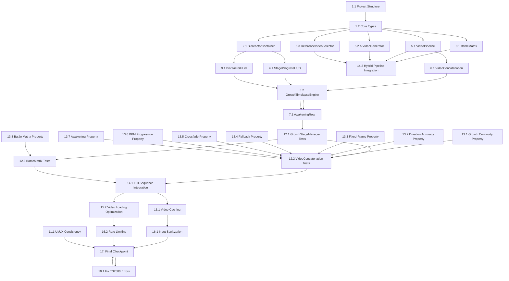

# Implementation Plan: Kiroween Rearchitecture

## Overview

This implementation plan covers the rearchitecture of Kiroween to support a 15-second documentary-style timelapse showing continuous biological growth from stem cell to adult monster across 6 distinct stages. The implementation includes modular component architecture, hybrid video pipeline with AI generation and fallback, fixed-frame rendering, 16x16 Monster Clash Arena expansion, and comprehensive error handling.

---

## Tasks

- [x] 1. Set up project structure and modular components
  - [x] 1.1 Create modular component directory structure
    - Create `src/components/bioreactor/` directory with subdirectories for awakening/, arena/, video-generation/
    - Ensure directory structure supports future component expansion
    - _Requirements: Overview, Architecture_
  
  - [x] 1.2 Extract and refactor core types and interfaces
    - Move MonsterDefinition, GrowthStage, BattleMatrix types to `src/types/kiroween.ts`
    - Create shared interfaces for video pipeline components
    - _Requirements: Data Models_

- [x] 2. Implement fixed-frame bioreactor container component
  - [x] 2.1 Create BioreactorContainer component
    - Implement fixed glass border (never moves/shakes)
    - Create video container that maintains position during fluid effects
    - _Requirements: 3.1 (Fixed-Frame Rendering Boundary)_
  
  - [x] 2.2 Implement fluid dynamics rendering
    - Create bubble animation system with rising bubbles
    - Implement surface wave calculation using sine waves
    - Calculate bubble opacity based on fluid level
    - _Requirements: 11.1, 11.2 (Bioreactor Fluid Effects)_

- [x] 3. Implement 15-second 6-stage growth timelapse engine
  - [x] 3.1 Create GrowthStage configuration and stage manager
    - Define GROWTH_STAGES array with exact timing (0.0-2.5s, 2.5-5.0s, etc.)
    - Implement stage duration validation (2.5s per stage = 15.0s total)
    - _Requirements: 1.1, 2.1 (Complete Sequence & Stage Duration)_
  
  - [x] 3.2 Implement GrowthTimelapseEngine component
    - Create stage timer logic with 2.5s intervals
    - Implement BPM progression (58 → 66 → 105 → 142 → 192 → 255 → 260+)
    - Trigger stage change callbacks
    - _Requirements: 2.2 (Timing Accuracy), 6.1 (BPM Progression)_

- [x] 4. Implement stage progress HUD display
  - [x] 4.1 Create StageProgressHUD component
    - Display current stage label (① STEM CELL through ⑥ ADULT)
    - Show progress bar (0% → 100%)
    - Display BPM with color coding (green/yellow/red)
    - _Requirements: 12.1, 12.2 (Stage Progress HUD)_

- [x] 5. Implement hybrid video pipeline with AI fallback
  - [x] 5.1 Create VideoPipeline service layer
    - Implement hybrid logic (AI API if available, reference video fallback)
    - Add error handling for AI API failures
    - _Requirements: 4.1 (Hybrid Video Pipeline)_
  
  - [x] 5.2 Implement AIVideoGenerator service
    - Add cache checking with SHA256 hash of prompt
    - Implement AI video generation via HuggingFace or Luma API
    - Handle API timeouts and errors gracefully
    - _Requirements: 10.1, 10.2 (Video Cache Management), 9.1 (API Error Handling)_
  
  - [x] 5.3 Create ReferenceVideoSelector service
    - Extract 6 stage clips from reference battle videos
    - Implement fallback to generic "dragon_vs_kraken" video
    - _Requirements: 4.2 (Fallback Video Selection)_

- [x] 6. Implement video concatenation with crossfade transitions
  - [x] 6.1 Create VideoConcatenationService
    - Implement 0.15s crossfade transitions between stages
    - Validate total duration = 15.0s exactly
    - Handle concatenation failures gracefully
    - _Requirements: 5.1 (Video Crossfade Quality)_

- [x] 7. Implement awakening roar trigger and effects
  - [x] 7.1 Create AwakeningRoar component
    - Play awakening roar video from `public/videos/chimera_awakening_*.mp4`
    - Trigger multi-harmonic roar audio from `public/sounds/monster_roar_*.wav`
    - Animate glass cracks (visual effect)
    - _Requirements: 7.1 (Final Stage Awakening Roar), 13.1 (Awakening Audio Synthesis)_

- [x] 8. Expand Monster Clash Arena to 16x16
  - [x] 8.1 Create BattleMatrix data structure
    - Implement 16x16 monster pair generation (240 unique combinations)
    - Create video URL mapping for all pairs
    - Implement fallback logic for missing videos
    - _Requirements: 8.1, 8.2 (16x16 Battle Matrix)_

- [x] 9. Implement BioreactorFluid component
  - [x] 9.1 Create fluid dynamics simulation
    - Implement bubble generation and animation
    - Calculate bubble speed based on BPM (higher BPM = faster bubbles)
    - Update surface wave frequency based on current stage
    - _Requirements: 11.1, 11.2 (Bioreactor Fluid Effects)_

- [x] 10. Fix TypeScript compilation errors
  - [x] 10.1 Resolve TS2580 errors in api/generate-video.ts
    - Add missing explicit 'void' return type to async function
    - Ensure all async functions have proper type annotations
    - Verify TypeScript configuration supports modern JavaScript features
    - _Requirements: Implementation Checklist_

- [x] 11. Implement UI/UX consistency improvements
  - [x] 11.1 Standardize component styling
    - Apply consistent color scheme (bioluminescent, deep sea, cyber themes)
    - Ensure uniform button styles across components
    - _Requirements: Overview (UI/UX Consistency)_

- [x] 12. Write unit tests
  - [x] 12.1 Write GrowthStageManager unit tests
    - Test stage duration accuracy (2.5s per stage)
    - Test BPM progression through all 6 stages
    - Test stage label display
    - _Requirements: Testing Strategy (Unit Testing)_
  
  - [x] 12.2 Write VideoConcatenationService unit tests
    - Test crossfade transition timing (0.15s)
    - Test video URL generation
    - Test stage extraction from reference videos
    - _Requirements: Testing Strategy (Unit Testing)_
  
  - [x] 12.3 Write BattleMatrix unit tests
    - Verify 16x16 matrix generation (240 combinations)
    - Test video URL selection logic
    - Test fallback video assignment for missing pairs
    - _Requirements: Testing Strategy (Unit Testing)_

- [x] 13. Write property-based tests
  - [x] 13.1 Write property test for growth sequence continuity
    - **Property 1: Growth Sequence Continuity**
    - **Validates: Requirements 1.1, 1.2**
    - Test that all 6 stages play in order with 15.0s total duration
  
  - [x] 13.2 Write property test for stage duration accuracy
    - **Property 2: Stage Duration Accuracy**
    - **Validates: Requirements 2.1, 2.2**
    - Test that each stage plays for exactly 2.5 seconds
  
  - [x] 13.3 Write property test for fixed-frame boundary
    - **Property 3: Fixed-Frame Boundary**
    - **Validates: Requirements 3.1**
    - Test that outer glass border remains stationary
  
  - [x] 13.4 Write property test for video source fallback
    - **Property 4: Video Source Fallback**
    - **Validates: Requirements 4.1**
    - Test automatic fallback to reference videos when AI fails
  
  - [x] 13.5 Write property test for crossfade transition smoothness
    - **Property 5: Crossfade Transition Smoothness**
    - **Validates: Requirements 5.1**
    - Test 0.15s crossfade timing with no gaps or flickering
  
  - [x] 13.6 Write property test for BPM progression logic
    - **Property 6: BPM Progression Logic**
    - **Validates: Requirements 6.1**
    - Test BPM progression through all stages matches specification
  
  - [x] 13.7 Write property test for final stage awakening
    - **Property 7: Final Stage Awakening**
    - **Validates: Requirements 7.1**
    - Test that Stage ⑥ triggers awakening cut-in correctly
  
  - [x] 13.8 Write property test for arena battle matrix completeness
    - **Property 8: Arena Battle Matrix Completeness**
    - **Validates: Requirements 8.1**
    - Test that all 16x16 monster pairs return valid video URLs

- [x] 14. Write integration tests
  - [x] 14.1 Write full growth sequence integration test
    - Test user selects monster → system generates/concatenates 6-stage video
    - Test bioreactor renders with HUD → stage transitions occur at correct times
    - Test final awakening triggers correctly
    - _Requirements: 1.1, 2.1, 3.1, 6.1, 7.1, 12.1_
  
  - [x] 14.2 Write hybrid video pipeline integration test
    - Test AI API available → generate via AI
    - Test AI API unavailable → use reference videos
    - Test cache hit → use cached video
    - Test cache miss → generate and cache
    - _Requirements: 4.1, 9.1, 10.1, 10.2_

- [x] 15. Performance optimization
  - [x] 15.1 Implement video caching system
    - Cache generated videos in localStorage (client-side)
    - Implement 24-hour expiry policy
    - Limit cache to 50 entries maximum
    - _Requirements: 10.1, 10.2 (Video Cache Management)_
  
  - [x] 15.2 Optimize video loading strategy
    - Load only current stage video
    - Preload next stage video in background
    - Implement lazy loading for off-screen components
    - _Requirements: Performance Considerations_

- [x] 16. Security validation and testing
  - [x] 16.1 Implement input sanitization
    - Sanitize video URLs to prevent XSS
    - Validate API endpoints before calls
    - _Requirements: Security Considerations (XSS Prevention)_
  
  - [x] 16.2 Implement rate limiting
    - Add rate limiting to AI video generation API calls
    - Implement timeout handling (60s max)
    - _Requirements: Security Considerations (Denial of Service)_

- [x] 17. Final checkpoint - Ensure all tests pass
  - Ensure all property-based tests pass (100+ iterations each)
  - Ensure all unit tests pass
  - Ensure all integration tests pass
  - Verify 15-second duration accuracy
  - Verify fixed-frame boundary (no shaking)
  - Verify all 16x16 battle combinations return valid videos
  - Ask the user if questions arise.

---

## Notes

- Tasks marked with `*` are optional and can be skipped for faster MVP
- Core implementation tasks should never be marked optional
- Property tests validate universal correctness properties
- Unit tests validate specific examples and edge cases
- Integration tests validate end-to-end flows

### Performance Optimization Notes
- Video caching is critical for reducing redundant API calls
- Lazy loading essential for initial page load performance
- Memory management important for long-running growth sequences

### Security Critical Items
- Input validation must be applied to all user-provided values
- CORS protection required for all external API calls
- Rate limiting essential to prevent API abuse

---

## Task Dependency Graph

### Visual Dependency Graph



### Execution Waves

Tasks are organized into 8 execution waves for parallel scheduling. Tasks in the same wave can run in parallel; tasks in wave N can only execute after all tasks in waves 0..N-1 complete.

```json
{
  "waves": [
    {
      "id": 0,
      "tasks": ["1.1", "1.2"]
    },
    {
      "id": 1,
      "tasks": ["2.1", "8.1", "5.1", "5.2", "5.3", "4.1", "9.1"]
    },
    {
      "id": 2,
      "tasks": ["6.1", "3.2", "3.1"]
    },
    {
      "id": 3,
      "tasks": ["7.1", "10.1", "11.1"]
    },
    {
      "id": 4,
      "tasks": ["12.1", "12.2", "12.3"]
    },
    {
      "id": 5,
      "tasks": ["13.1", "13.2", "13.3", "13.4", "13.5", "13.6", "13.7", "13.8", "14.1", "14.2"]
    },
    {
      "id": 6,
      "tasks": ["15.1", "15.2", "16.1", "16.2"]
    },
    {
      "id": 7,
      "tasks": ["17"]
    }
  ]
}
```
