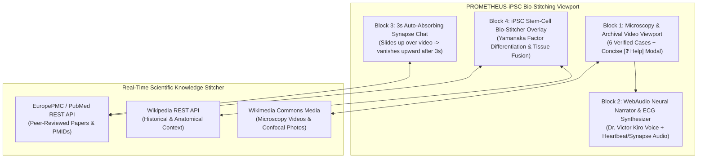
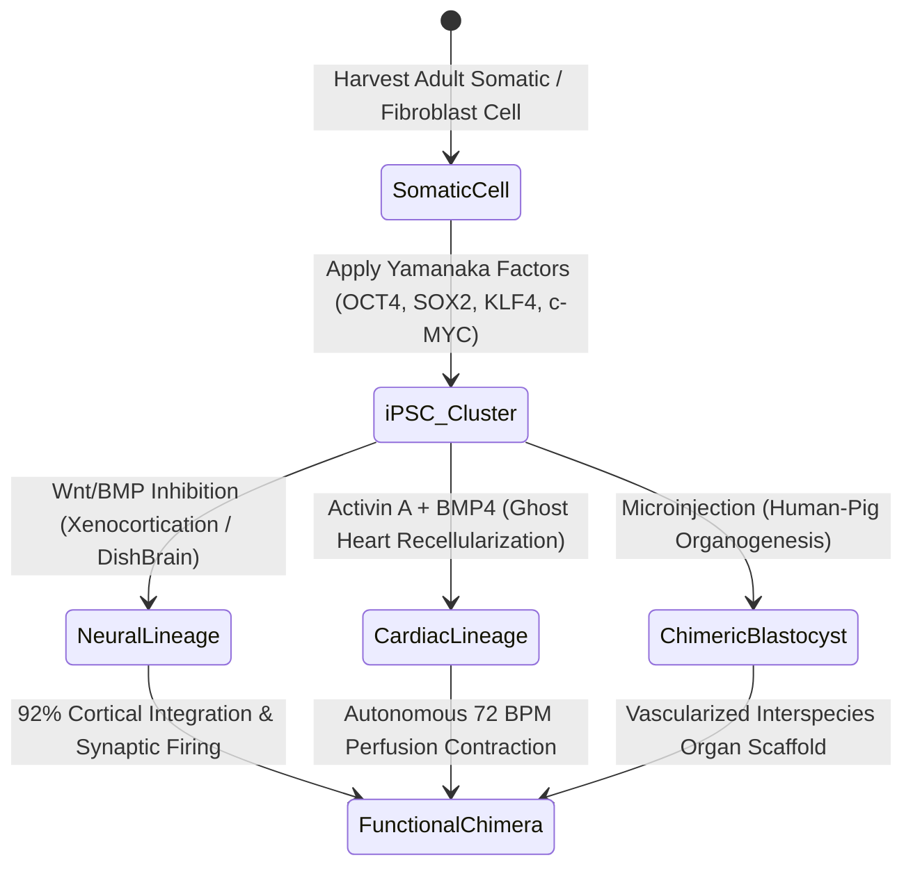

# System Design: PROMETHEUS-iPSC (Frankenstein Track)

## 1. High-Level Chimera Architecture

## 2. Pluripotent Stem-Cell (iPSC) Differentiation State Machine

## 3. Component Breakdown
1. `src/data/bioExperiments.ts`: Curated dataset of the 6 real-world modern Frankenstein experiments with verified PubMed PMIDs, DOIs, Wikimedia Commons microscopy video/image URLs, and iPSC differentiation protocols.
2. `src/services/scienceStitchService.ts`: Real-time asynchronous client that queries EuropePMC (`ebi.ac.uk/europepmc/webservices/rest/search`) and Wikipedia REST APIs (`en.wikipedia.org/api/rest_v1/page/summary/`) and stitches them into a unified Chimera Research Dossier.
3. `src/components/BioStitchLabView.tsx`: Main responsive laboratory interface integrating the 4 core blocks, real-time ECG/synapse canvas visualizer, 3-second auto-dismissing mobile floating chat, and the `[❓ Help]` modal.
