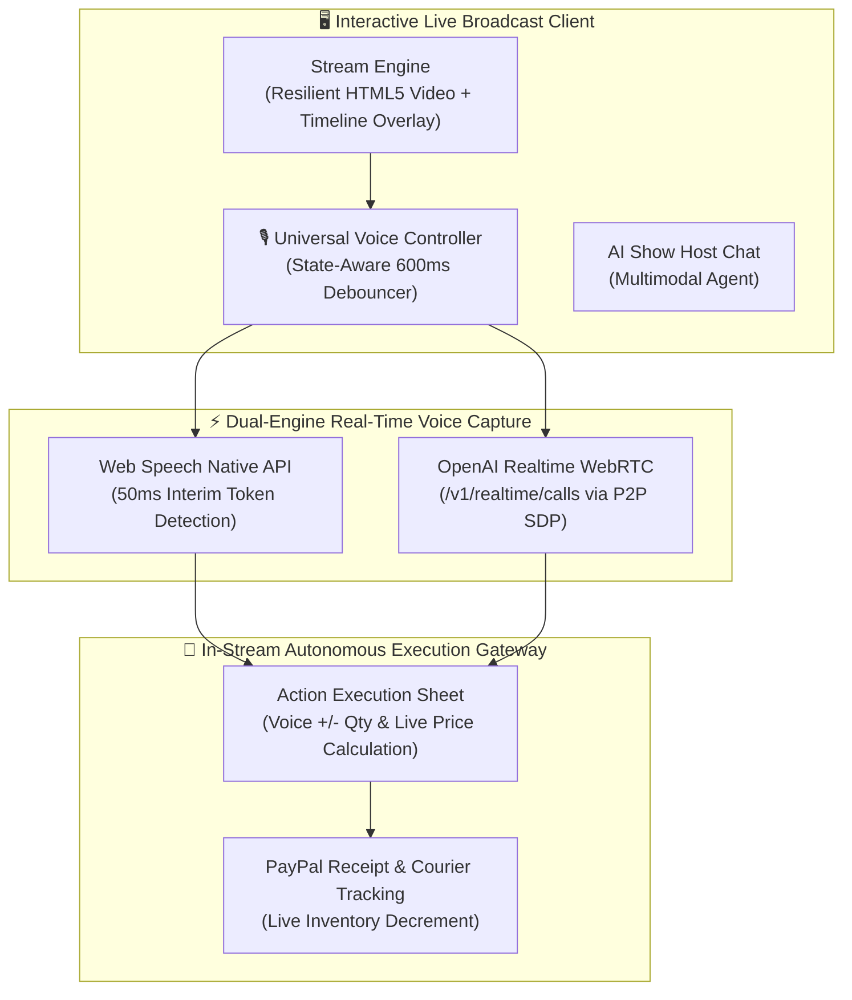

# 🎃 Kiroween: Multimodal Agentic Video Commerce
> **Kiroween 2026 ($100k Hackathon) Submission**  
> **Target Tracks**: 🏆 Best Agentic Application | 🎭 Frankenstein & Costume Contest  
> **Core Concept**: Autonomous Live Video Understanding + Ultra-Low-Latency Voice Checkout Pipeline

[](https://react.dev/)
[](https://www.typescriptlang.org/)
[](https://vitejs.dev/)
[](https://tailwindcss.com/)
[](https://platform.openai.com)
[](https://developer.mozilla.org/en-US/docs/Web/API/Web_Speech_API)

---

## 📌 Executive Summary

Traditional live commerce forces users to leave the video stream to tap small checkout buttons, fill in quantities, and go through multi-step redirects—causing severe drop-off rates.

**Kiroween** transforms passive video streaming into an **autonomous agentic shopping experience**. Powered by a **Dual-Engine Voice Pipeline (Web Speech 50ms + OpenAI Realtime WebRTC)**, viewers can interact with an AI show host and execute in-stream checkouts simply by speaking:

> *"결제창"* (Open checkout) ➡️ *"더하기"* (Add quantity) ➡️ *"결제"* (Confirm & pay)  
> All handled seamlessly within the live video window with zero disruption and instant PayPal order receipt generation.

---

## ⚡ Key Highlights & Architecture

### 1. Dual-Engine Real-Time Voice Checkout (Dual-Engine Pipeline)
- **Engine 1: Browser-Native Web Speech (`interimResults = true`)**: Zero-network latency (50~100ms) capture of intent tokens for immediate modal triggers.
- **Engine 2: OpenAI Realtime WebRTC (`/v1/realtime/calls`)**: Bidirectional audio streaming with tool calling (`open_checkout`) and voice activity detection (VAD).
- **Universal Voice Controller (`voiceButtonController.ts`)**: State-aware debounced event controller (600ms) that switches context between *Closed Modal (trigger checkout)* and *Open Sheet (quantity control & payment execution)*.

### 2. High-Octane Cyberpunk / Halloween UI (`Costume Contest` Track)
- Specially tailored high-contrast neon theme featuring interactive glowing HUDs, dynamic video overlays, and retro-futuristic telemetry.

### 3. Timeline-Synchronized Live Video Overlays
- Real-time video playback synchronization showing product highlights, certification stamps, and flash-sale markers accurately locked to video timestamps.

### 4. Seller Admin Studio
- Integrated seller studio allowing creators to map live video timestamps, update product catalogs, and orchestrate inventory on the fly.

### 5. Multilingual Native Comprehension (6 Global Languages)
- Fully localized across **English (EN), Korean (KO), Japanese (JA), Chinese (ZH), Spanish (ES), and French (FR)**.

---

## 🏗️ System Architecture



---

## 🗣️ Multilingual Voice Command Guide

| Action | Korean (KO) | English (EN) | Japanese (JA) | Chinese (ZH) |
|---|---|---|---|---|
| **Open Checkout** | 결제창, 구매창, 이거 살래 | checkout, open checkout, buy this | 決済画面, 購入画面, これ買う | 结账, 结算页面, 我要买 |
| **Increase Qty (+1)** | 더하기, 하나 더, 플러스 | add, plus, more, one more | 増やす, プラス, もう一つ | 增加, 加, 多一个 |
| **Decrease Qty (-1)** | 빼기, 하나 빼, 마이너스 | minus, less, one less | 減らす, マイナス | 减少, 减, 少一个 |
| **Approve Payment** | 결제, 결제하기, 구매하기 | pay, pay now, confirm | 決済, 決済する, 購入 | 付款, 立即付款, 支付 |
| **Cancel / Close** | 취소, 취소하기, 닫기 | cancel, close, exit | キャンセル, 閉じる | 取消, 关闭 |

---

## 📂 Project Structure

```text
kiroween/
├── .kiro/
│   ├── specs/architecture.md    # System Architecture Specification
│   ├── steering.md             # Project Steering & Anti-Regression Rules
│   └── hooks.json              # Kiro Spec hooks
├── docs/
│   └── VOICE_CHECKOUT_PIPELINE.md # In-depth Voice Checkout Pipeline Spec
├── public/
│   └── videos/                 # Demo Stream Assets (honey_demo.mp4, tea_demo.mp4)
├── src/
│   ├── modules/
│   │   ├── stream/             # Module 1: Resilient Stream Player & Overlays
│   │   ├── agent/              # Module 2: Multimodal AI Agent (WebRTC & Chat)
│   │   ├── action/             # Module 3: Instant Execution Gateway (Sheet & Receipt)
│   │   ├── admin/              # Module 4: Seller Admin Studio
│   │   └── voice/              # Dual Voice Pipeline & State-Aware Controller
│   ├── i18n/                   # 6-Language Localization Translations
│   ├── App.tsx                 # Master Orchestration Entrypoint
│   └── main.tsx
├── testvoice/                  # Standalone Voice Lab Prototype Sandbox
├── package.json
└── vite.config.ts
```

---

## 🚀 Getting Started

### 1. Prerequisites
- **Node.js**: v18.0.0 or higher
- **npm** or **pnpm**
- Modern Chromium-based browser (Chrome, Edge) with microphone permissions enabled.

### 2. Installation
```bash
git clone https://github.com/your-username/kiroween.git
cd kiroween
npm install
```

### 3. Environment Configuration
Create a `.env.local` file by copying the template:
```bash
cp .env.example .env.local
```

Configure your OpenAI API credentials in `.env.local`:
```env
OPENAI_API_KEY=your_openai_api_key_here
OPENAI_MODEL=gpt-realtime
```
*(Note: You can also input the OpenAI API key directly within the in-app Voice Settings UI).*

### 4. Launch Development Server
```bash
npm run dev
```
Open [http://localhost:5174](http://localhost:5174) in your browser.

### 5. Production Build & Verification
```bash
# Type check & build
npm run build

# Preview production bundle
npm run preview
```

---

## 🛡️ Technical Resilience & Anti-Regression Standards

- **Strict OpenAI WebRTC Spec**: Adheres strictly to the `/v1/realtime/client_secrets` ephemeral authentication and `/v1/realtime/calls` multipart SDP contract with automatic fallback between `gpt-realtime` and `gpt-4o-realtime-preview`.
- **Fault-Isolated Micro-Modules**: All critical sections (Stream, Agent, Action Sheet) are wrapped with robust `ErrorBoundary` components to prevent catastrophic UI cascading failures.
- **Resource Management**: Fully optimized background audio buffers and WebSocket connections with automatic cleanup on unmount.

---

## 📜 License

This project is licensed under the MIT License - see the [LICENSE](LICENSE) file for details.
