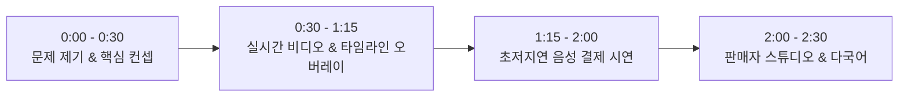

# 🎬 Kiroween 2026 해커톤 2~3분 데모 영상 시연 가이드 (Demo Script)

본 문서는 **Kiroween 2026 ($100k Hackathon)** 심사위원을 사로잡기 위한 **2~3분 시연 영상(Loom / YouTube) 촬영 대본 및 시나리오**입니다.

---

## ⏱️ 타임라인별 시연 대본 (Total: 2분 30초)

### [0:00 ~ 0:30] 인트로 & 문제 제기 (Introduction)
* **화면**: `http://localhost:5174` (사이버펑크/할로윈 테마 메인 화면 풀스크린)
* **멘트**:
  > "안녕하세요, Kiroween 2026 출품작 **Multimodal Agentic Video Commerce**입니다.  
  > 기존 라이브 커머스는 상품을 사려면 영상을 멈추거나 별도 페이지로 이탈해야 해서 시청 흐름이 끊기고 구매 이탈률이 높았습니다.  
  > Kiroween은 **영상 시청을 단 1초도 중단하지 않고, 오직 목소리만으로 상품 탐색부터 수량 조절, 결제 및 영수증 발행까지 끝내는 에이전틱 쇼핑 경험**을 제공합니다."

---

### [0:30 ~ 1:15] 모듈 1 & 2: 실시간 스트림 & 멀티모달 AI 호스트
* **화면 조작**:
  1. 비디오가 재생되는 동안 상단의 **타임라인 마커(0초, 7초, 16초, 28초)**가 실시간으로 하이라이트되는 모습 포착.
  2. 우측 채팅창에서 텍스트 입력 또는 음성 질문:
     - 질문: *"이 꿀 원산지가 어디야?"* 또는 *"유통기한은 어떻게 돼?"*
     - AI 호스트(`🤖`)가 즉각 상품 메타데이터를 기반으로 답변하는 모습을 보여줌.
* **멘트**:
  > "보시는 것처럼 영상 재생 타임라인에 맞춰 실시간 오버레이 마커가 동기화되며, 우측 AI 쇼호스트는 영상 속 상품의 원산지와 스펙을 실시간으로 안내합니다."

---

### [1:15 ~ 2:00] 모듈 3: 초저지연 실시간 음성 결제 (🔥 핵심 하이라이트)
* **화면 조작**:
  1. 마이크를 켜고 화면을 보며 발화:
     - 🗣️ **"결제창"** (또는 *"이거 살래"*)
     - ⚡ **결과**: 50ms 이내에 즉각 하단에서 `ActionExecutionSheet` 결제 모달이 팝업!
  2. 결제창이 열린 상태에서 발화:
     - 🗣️ **"더하기"** (수량이 1 ➡️ 2로 증가, 원화/달러 총액 즉각 재계산)
     - 🗣️ **"하나 더"** (수량이 2 ➡️ 3으로 증가)
  3. 결제 승인 발화:
     - 🗣️ **"결제"** (또는 *"결제하기"*)
     - ⚡ **결과**: PayPal 승인 시뮬레이션 후 즉각 폭죽 애니메이션과 함께 **공식 영수증 모달(`PayPalReceiptModal`)** 팝업 및 주문번호/트래킹 번호 생성, 실시간 재고 차감 확인!
* **멘트**:
  > "화면에 손을 대지 않고 오직 음성 명령만으로 '결제창' 호출, '더하기'로 수량 조절, '결제'로 즉각 주문 승인과 영수증 발행까지 단 5초 만에 완료됩니다. 브라우저 네이티브 Web Speech와 OpenAI Realtime WebRTC의 하이브리드 지능으로 50ms 초저지연을 실현했습니다."

---

### [2:00 ~ 2:30] 모듈 4: 판매자 스튜디오 & 다국어 전환
* **화면 조작**:
  1. 화면 우측 상단의 **'판매자 스튜디오(Admin Studio)'** 버튼 클릭.
  2. 상품의 비디오 URL(`/videos/tea_demo.mp4`), 가격, 타임라인 마커를 실시간 수정하는 장면 노출.
  3. 상단 언어 선택기를 눌러 **영어(EN), 일본어(JA)** 등으로 즉시 언어가 전환되는 장면 노출.
* **멘트**:
  > "크리에이터와 판매자는 실시간 스튜디오에서 영상 타임라인과 마커를 마음대로 제어할 수 있으며, 6개 글로벌 언어를 완벽 지원합니다. 시청자와 판매자 모두를 위한 차세대 에이전틱 커머스, Kiroween이었습니다. 감사합니다!"

---

## 📁 비디오 등록 위치 및 파일명 가이드

### 1. 인앱 비디오 스트림 파일 (앱 내부에서 재생되는 영상)
- **저장 위치**: `public/videos/`
- **현재 등록된 파일**:
  - `public/videos/honey_demo.mp4` (양평 아카시아 벌꿀 데모 스트림)
  - `public/videos/tea_demo.mp4` (핸드메이드 전통차 데모 스트림)
- **새로운 비디오 추가 방법**:
  1. 원하는 mp4 비디오 파일을 `public/videos/새파일명.mp4`에 복사합니다.
  2. 앱 화면 우측 상단의 **판매자 스튜디오(Admin Studio)** 모달에서 상품 추가/수정 시 Video URL에 `/videos/새파일명.mp4`를 입력하거나, `src/App.tsx`의 `INITIAL_PRODUCTS` 배열에 등록하면 즉시 라이브 스트림으로 재생됩니다.

### 2. 해커톤 제출용 데모 시연 영상 (Judges Demo Video)
- **권장 업로드 플랫폼**: **YouTube (일부공개 또는 공개)** 또는 **Loom**
  - 해커톤 제출 규격상 동영상 파일 자체를 Git에 올리기보다는 스트리밍 가능한 링크를 제출 폼 및 README에 기재하는 것이 원칙입니다.
- **영상 제목 권장 예시**: `[Kiroween 2026] Multimodal Agentic Video Commerce - Demo Video`
- **링크 등록 위치**: `README.md`의 `## 🎥 Live Demo & Video` 섹션에 URL을 삽입합니다.
