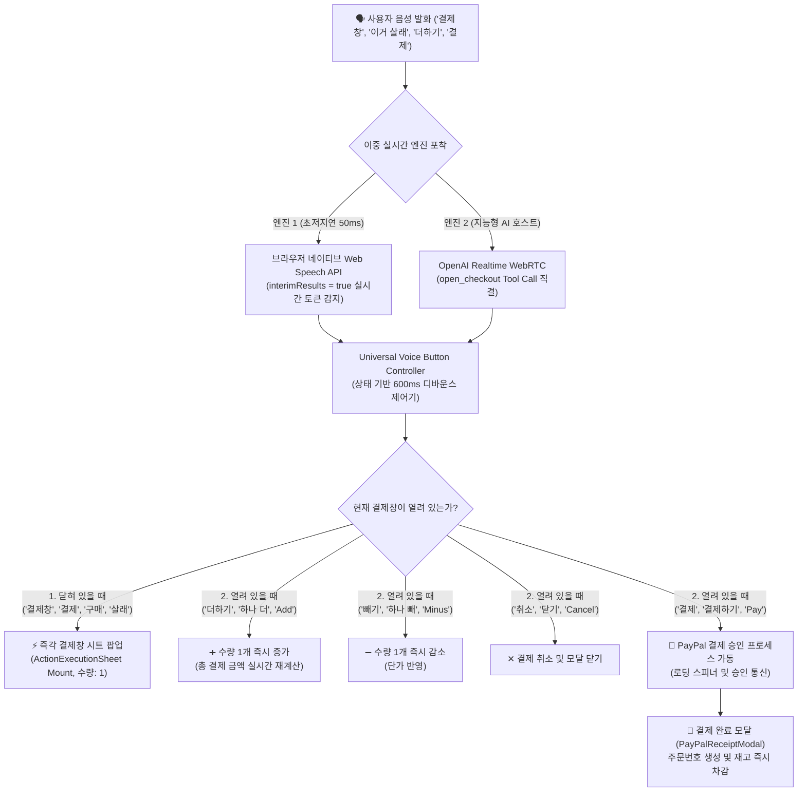

# Kiroween 실시간 음성 결제 파이프라인 아키텍처 (End-to-End Voice Checkout Pipeline)

본 문서는 사용자의 음성 발화("결제창", "더하기", "빼기", "결제", "취소" 등)가 마이크에 입력되는 순간부터, 실시간 감지 및 결제창 모달 제어, 최종 결제 승인 및 영수증 발행까지 이어지는 **초저지연 이중화 음성 커머스 실행 파이프라인**을 설명합니다.

---

## 1. 파이프라인 아키텍처 다이어그램 (Architecture Diagram)

---

## 2. 세부 단계별 실행 흐름 (Stage-by-Stage Breakdown)

### 1단계: 음성 수집 및 초저지연 감지 (Dual-Engine Capture)
- **엔진 1: 브라우저 네이티브 Web Speech (`interimResults = true`)**
  - 발화 완료 후 침묵 대기 시간(1.5초)을 제거하고, 사용자가 단어를 말하는 도중 부분 결과(Interim tokens)를 50~100ms 이내에 포착합니다.
  - 마이크 권한이 허용된 환경에서 별도의 서버 통신 지연 없이 즉시 트리거됩니다.
- **엔진 2: OpenAI Realtime WebRTC (`gpt-realtime`)**
  - 고품질 양방향 오디오 채널에서 Whisper 음성 전사 완료(`input_audio_transcription.completed`) 및 AI 도구 호출(`open_checkout`)을 실시간 병렬 처리합니다.

### 2단계: 상태 인지형 버튼 제어기 (`voiceButtonController.ts`)
- **디바운스(Debounce)**: 600ms 이내 동일 명령어의 중복 실행을 필터링하여 음성 떨림이나 반복 전사로 인한 오작동을 차단합니다.
- **모달 상태 분기 (State Awareness)**:
  - **모달 닫힘 상태**: 구매 의사 발화("결제창", "결제", "구매", "이거 살래") 감지 시 즉각 `kiroween:open_checkout` 이벤트를 디스패치합니다.
  - **모달 열림 상태**: 시트 내부의 액션("더하기", "빼기", "결제", "취소")으로 컨텍스트를 자동 전환합니다.

### 3단계: 결제 시트 인터랙션 (`ActionExecutionSheet.tsx`)
- **수량 조절**: "더하기" / "빼기" 명령으로 수량을 실시간 증감하며 원화/달러 총액을 즉각 재계산합니다.
- **결제 실행**: "결제" / "결제하기" 명령 감지 시 `handleExecute()`를 가동하여 결제 승인 시뮬레이션(1.2초)을 진행합니다.
- **취소 및 닫기**: "취소" 명령 감지 시 모달을 애니메이션과 함께 즉각 해제합니다.

### 4단계: 주문 생성 및 영수증 발행 (`PayPalReceiptModal.tsx`)
- 결제 완료 시 주문번호(`PAYPAL-XXXXXX`), 배송 추적번호(`PP-TRK-XXXXXX`), 승인 시각을 생성합니다.
- 상품의 재고 수량을 차감하고 실시간 영수증 모달을 전면에 띄웁니다.

---

## 3. 다국어 음성 명령어 지원표 (Multilingual Voice Command Reference)

| 기능 | 한국어 (KO) | English (EN) | 日本語 (JA) | 中文 (ZH) |
|---|---|---|---|---|
| **결제창 열기** | 결제창, 구매창, 이거 살래, 주문할래 | checkout, open checkout, buy this | 決済画面, 購入画面, これ買う | 结账, 结算页面, 我要买 |
| **수량 증가 (+1)** | 더하기, 하나 더, 플러스 | add, plus, more, one more | 増やす, プラス, もう一つ | 增加, 加, 多一个 |
| **수량 감소 (-1)** | 빼기, 하나 빼, 마이너스 | minus, less, one less | 減らす, マイナス | 减少, 减, 少一个 |
| **결제 승인** | 결제, 결제하기, 구매, 구매하기 | pay, pay now, confirm | 決済, 決済する, 購入 | 付款, 立即付款, 支付 |
| **취소/닫기** | 취소, 취소하기, 닫기, 그만 | cancel, close, exit | キャンセル, 閉じる | 取消, 关闭 |
